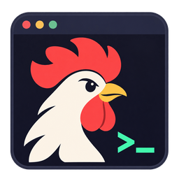

<p align="center">
  
</p>

# Terminal Rooster

A project-based terminal manager for running coding agents (Claude Code, Codex, Grok, …) side by side.

*TR, TermRoost or Rooster for short.*

- **Projects** on the left, each with a working directory.
- **Search** (Ctrl+Shift+P) above the projects list shows only the projects whose name or folder contains each word you type, ignoring case. **Enter** opens the first one and brings the whole list back; **Escape** empties the search and goes back to the terminal, **✕** just empties it. While you search, the next/previous project shortcuts go through the projects shown, and moving a project (by dragging or with the shortcuts) moves it among them.
- **Sessions** per project: vertical, renamable (double-click). Each session holds terminals in horizontal/vertical **splits**.
- **Reordering:** drag a project or session up or down its list; a line shows where it will land. Dropping it outside the list cancels. The move shortcuts below do the same from the keyboard.
- **Files** of the session's folder in the right panel's **Files** tab (Ctrl+Shift+F). Click a folder to open or close it, and a file to show it in place of the session's terminals (a strip above them switches between the terminals and the open files). What git ignores (`.gitignore`, `.git/info/exclude`, your global excludes) is dimmed; `.git` itself is not listed. The tree keeps up with changes by itself while it is shown, and **↻** reads it again at once. Right-click an entry, or the folder name at the top, for **Show in Explorer** (on Linux, your default file manager: it selects the file if the file manager supports that, else opens its folder).
- **Editing files:** a file opened from the Files tab can be edited where it is shown. **Ctrl+S** saves, **Ctrl+Z** undoes and **Ctrl+Y** (or Ctrl+Shift+Z) redoes; **Tab** and **Shift+Tab** indent and outdent the way the file already does (tabs or its number of spaces). Code is colored by its language, known by the file's extension. Saving keeps the file's line endings (LF or CRLF) and its byte order mark. A ● on the file's tab marks unsaved changes; closing the file, deleting its session or quitting asks first. Files larger than 5 MB, binary files and files that aren't UTF-8 don't open. Open files come back after a restart (their unsaved changes don't).
- **Files that change on disk** (say, an agent edits one you have open) are noticed within a few seconds, and when you come back to the window. Without unsaved changes, the file just shows the new text (undo brings back the old). With unsaved changes, a bar under the text offers **Reload** or **Keep mine**; a deleted file offers to be saved again. Saving over a file that changed since you opened it asks first.
- **Neovim mode:** in **Settings → Editor**, *Edit files with: Neovim or Vim* opens files in Neovim (or Vim, if there is no Neovim) running in a terminal in the same place, with your own configuration. Quitting it (`:q`) closes the file. Neovim hears when you look at it and when you look away, so with `autoread` it picks up changes agents make. A different editor command can be set there; the file's path is added at the end. Ctrl+Shift shortcuts and Alt+arrows stay with Terminal Rooster. Closing a file whose editor still runs, and quitting, ask first.
  - **Getting Neovim on Windows:** without a Neovim on PATH, **Settings → Editor → Neovim → Install and use** downloads a pinned Neovim release (the official zip), checks its SHA-256 and unpacks it with Windows' own `tar.exe` into `%LOCALAPPDATA%\TerminalRooster\data\nvim`, like the bash above. Nothing outside that folder changes; delete it to remove it. A Neovim of your own on PATH is used first.
  - **On Linux**, install Neovim with your package manager (`sudo apt install neovim`, `sudo dnf install neovim`, `sudo pacman -S neovim`); Settings says so when it finds none.
- **Tasks** per project in the right panel's **Tasks** tab. You can mark them done and link each one to a session, with its dropdown or by dragging the task onto a session in the list or onto the terminals on screen. Sessions show a badge with their open-task count.
- **Git:** each session shows the branch its directory is on. **Worktrees** (at the top of a session) lists the repository's worktrees; **Switch** moves the session to one, **New session** opens another session in it, and **Remove** deletes one (after asking). Removing closes the sessions working in the worktree, waits for their programs to exit (Windows cannot delete a folder a program is still in), and keeps the branch; uncommitted changes are only deleted when you tick **Delete them too**. Its **New worktree** part runs `git worktree add` beside the repository, so on the same drive (`app` → `app-feature-x`), and opens the worktree in a new session named after the branch, or moves this session there when **Move … into it** is checked. When a session moves, idle terminals restart in the worktree with their scrollback kept. Terminals running a program or an agent are left alone.
- **Git log:** for a session in a repository, the right panel has a **Git** tab between **Tasks** and **Files**. It lists the latest 200 commits of the session's branch, or of every branch with **All branches**: subject, id, author, age, and the branches and tags on each. New commits show up on their own within about two seconds. Between commits it only reads the files under `.git` that say where branches and tags point; it runs git only when one of them moved. Commits that are on no remote yet are marked **not pushed**, and a line says how far the branch is from its upstream ("2 commits to push · 1 to pull (origin/main)", as of the last fetch). **Pull** (with **Rebase**, on by default, which replays your commits on top of what came in instead of merging) and **Push** run git for you; a branch without an upstream is pushed to `origin` and tracks it from then on. git gets 5 minutes for either, so a login prompt it cannot show won't leave it waiting forever.
- **Everything is persisted in SQLite** as it changes: projects, sessions, split layouts, focus, tasks, window geometry, terminal scrollback and the directory each terminal's shell is in. After a crash or a normal close, the app reopens as you left it.

## Running

### Linux

```sh
cargo run --release -p termroost-iced
```

Running a build straight from `target/` (not from a package) writes a hidden desktop entry and the icons into `~/.local/share`. KDE and GNOME need that entry to show Terminal Rooster's icon for its window on Wayland. Once a package is installed, Terminal Rooster removes this entry again. Set `TERMINALROOSTER_NO_DESKTOP_ENTRY=1` to skip it.

### Windows (installer)

Run `TerminalRooster-<version>-x64-setup.exe` (see [Packaging (Windows)](#packaging-windows) to build it). It installs for the current user only, so it needs no administrator rights. It installs to `%LOCALAPPDATA%\Programs\TerminalRooster` and adds a Start menu shortcut, plus an optional desktop shortcut. Uninstall it from *Settings → Apps*. Uninstalling keeps your data.

### Windows (native build)

1. Install Rust with [rustup](https://rustup.rs) (default MSVC toolchain).
2. Install the Visual Studio Build Tools with the "Desktop development with C++" workload. SQLite is compiled from source.
3. In the repository folder, run:

   ```powershell
   cargo build --release
   .\target\release\terminalrooster.exe
   ```

Windows 10 1809 or newer is required, for ConPTY. Terminals use `pwsh` if it is installed, otherwise Windows PowerShell, otherwise `cmd`. Release builds do not open a console window.

**Bash on Windows:** Settings → Terminal lists the shells it finds (Git Bash, MSYS2, each WSL distribution, PowerShell, cmd), for the default shell and for each project. Without any bash installed, **Terminal Rooster bash → Install and use** downloads a pinned Git for Windows release (bash with coreutils, vim, less, ssh and git), checks its SHA-256, and unpacks it with Windows' own `curl.exe` and `tar.exe` into `%LOCALAPPDATA%\TerminalRooster\data\bash`. Nothing outside that folder changes. Delete the folder to remove it.

### Where data lives

| Platform | Location |
|---|---|
| Linux | `~/.local/share/terminalrooster/terminalrooster.db` |
| Windows | `%APPDATA%\TerminalRooster\data\terminalrooster.db` |

Set `TERMINALROOSTER_DATA_DIR` to use another directory. Only one instance can run per data directory.

## Themes

Open **Settings** with the ⚙ in the projects header.

- **Interface theme:** click **Use** on a theme. **Dark** (Tokyo Night) and **Light** (GitHub-light style) are built in.
- **Match the system's light/dark setting** (on by default): the app switches between the last light theme and the last dark theme you used, following the OS live.
- **Terminal colors:** match the interface, or always use one theme's terminal colors. For example, you can have dark terminals with a light interface.
- **Custom themes:** **Duplicate** a theme, then edit it.
  - You can change its name, its interface colors (background, text, accent, success, warning, danger) and its terminal colors (foreground, background, cursor, selection and the 16 ANSI colors).
  - Type a `#rrggbb` color, or click a color's square to pick one: a palette of ready-made colors, the colors the theme already uses, and hue/saturation/lightness sliders.
  - Edits apply live and are saved automatically.

Terminals switch colors instantly, including their scrollback. Programs that ask the terminal for its colors get the new ones. Coding agents usually have their own light/dark setting; for example, set Claude Code's `/theme` to match.

## Notifications

Terminal Rooster tells you when something happens in a terminal you aren't looking at:

- **Coding agents:** Claude Code, Codex or Grok finishes its turn, needs an approval, or asks a question.
- **Failed commands:** a command exits with an error status, or a terminal's shell does.

In **Settings → Notifications**, each of the two can be **Off**, **Subtle** or **Prominent**. By default, agents are Prominent and failed commands are Subtle.

- **Subtle:** a ✓ (agent) or ✗ (failure) next to the session and the project, and a label in the terminal's title bar. These stay until you focus that terminal.
- **Prominent:** the same marks. If the terminal is out of view, a note also pops up in the top right corner; **Show** takes you to it. While Terminal Rooster is in the background, you get a desktop notification instead and the taskbar entry flashes. Clicking the notification brings up the terminal.

The terminal you are looking at never notifies. **Send a test notification** in Settings checks that desktop notifications get through. On Windows, Terminal Rooster registers its name and icon for them under `HKCU\Software\Classes\AppUserModelId`, and the uninstaller removes that again.

### How it knows

No agent needs any setup.

| Source | What Terminal Rooster reads |
|---|---|
| Claude Code | Its terminal title: `◐`/`◑` while it works, `✳` once it is done or waiting for you |
| Codex | The state it reports to the terminal (`OSC 7501`: working, done, error, waiting for an approval) |
| Grok and other programs | Desktop notification requests (`OSC 9`, `OSC 777`, `OSC 99`), progress indicators (`OSC 9;4`), and the bell in a terminal running an agent |
| Failed commands | The exit status the shell reports after each command (`OSC 133;D`) |

**Shell integration:** bash and PowerShell (`pwsh`, `powershell`) don't report exit statuses or their working directory by themselves, so Terminal Rooster loads a small script into them when a terminal starts. The scripts live in the data directory, in `shell-integration/`, and your startup files are not changed:

- **bash** gets `PROMPT_COMMAND` in its environment. That sources the script at the first prompt, after `~/.bashrc`. If your `~/.bashrc` replaces `PROMPT_COMMAND` instead of adding to it, there is no integration.
- **PowerShell** runs the script after your profile, with `-NoExit -Command`. This is skipped when the shell's command line already runs a command or a file.

Other shells (zsh, fish, cmd, WSL) start unchanged. They work too if something in them sends `OSC 133;D;<status>`, and `OSC 7` or `OSC 9;9` for the directory (fish and many prompt themes do). Turn the integration off in Settings → Notifications.

### Quitting with programs running

Closing the window while terminals run programs (an agent, a build, a server) asks first and lists them. Agents come back in the same conversation on the next start, but a reply they are writing is cut off. Choose **Don't ask again** there, or switch it off in Settings → Notifications. Programs inside WSL can't be seen from Windows, so WSL terminals never count.

## Logging

Terminal Rooster logs with `tracing`, to stderr and to a daily file that keeps the last 7 days:

| Platform | Log location |
|---|---|
| Linux | `~/.local/share/terminalrooster/logs/` |
| Windows | `%APPDATA%\TerminalRooster\data\logs\` |

Panics are written to the log with a backtrace. The level comes from `TERMINALROOSTER_LOG`, then `RUST_LOG`; the default is `info`. For example, `TERMINALROOSTER_LOG=debug` logs every command, and `TERMINALROOSTER_LOG=terminalrooster=trace` logs every UI message. Keystrokes are never logged.

## Restoring after a restart or crash

Terminal processes cannot survive a crash, and they end when the app closes. On reopen, every terminal gets the following:

- Its **saved scrollback**, with colors. It is saved every 5 seconds and on close. It stays on screen, and a "restored session" banner separates it from the new shell's prompt. Terminals that were running a coding agent skip this: the agent shows its own conversation again when it resumes.
- A **fresh shell** in the directory the last one was in, if the shell reported it (see **Shell integration** under [How it knows](#how-it-knows)). Otherwise, or if that directory is gone, it starts in the session's working directory.
- Its **resume command**, which runs automatically.

Restored sessions start their shells the first time you open them, so dozens of agents don't all launch at once.

### Exact agent sessions, not "continue last"

`--continue` and `resume --last` reopen the most recent conversation in a folder, which is wrong when several agents work in one project. Terminal Rooster watches each terminal's processes instead (every 5 seconds, and once more on shutdown). It finds the coding agent running there and reads the agent's session id from the agent's own records:

| Agent | Where the session id comes from | Restore command |
|---|---|---|
| Claude Code | `~/.claude/sessions/<pid>.json`, rewritten on `/clear` | `claude --resume <id>` |
| Grok | `~/.grok/active_sessions.json` (`pid` → `session_id`) | `grok --resume <id>` |
| Codex | Codex's thread table (`~/.codex/state_*.sqlite`): the newest user thread in the process's folder started after the process, or the id in `codex resume <id>` | `codex resume <id>` |

- **How agents are found:** it works whether you start the agent with **Start agent** or type `claude` yourself. It follows `/clear`, `/new` and `/resume`, and it forgets the agent when you quit it.
- **Missing sessions:** if a session never got a message, so nothing is saved to resume, the agent is started fresh instead.
- **Extra arguments:** arguments set in terminal settings (e.g. `--model opus`) are reused on resume.
- **Codex accuracy:** Codex runs every terminal through one shared daemon and keeps no per-process record, so by default its session is inferred. That is exact with one Codex per folder. For exact tracking, add the optional **Codex hook**. Terminal Rooster offers it once at startup, and you can also add it from Settings → Integrations. Codex only runs hooks you trust, so Terminal Rooster then opens a small Codex window: type `/hooks` there and trust it. The hook goes in `~/.codex/hooks.json`, your other hooks are kept, and it only writes while Terminal Rooster runs.
- **Debugging detection:** `cargo run -p termroost-core --example detect_agents -- <shell pid>…` prints what is detected under any shell.

## Shortcuts

Terminals receive every plain `Ctrl+letter`. The default app shortcuts use `Ctrl+Shift`, `Alt` or `Shift` with keys like PgUp.

Every keyboard shortcut can be changed in **Settings → Keyboard shortcuts**: click **+** next to an action and press the keys, or **✕** to remove a shortcut. An action can have several shortcuts. Giving keys to one action takes them away from any other, and the page says so. Letters and symbols need Ctrl, Alt or the Windows/Super key, so normal typing can't be taken over. **Reset** restores an action's defaults.

| Default keys | Action |
|---|---|
| Ctrl+Shift+N | New project |
| Ctrl+Shift+T | New session |
| Ctrl+Shift+E / Ctrl+Shift+O | Split right / split down |
| Ctrl+Shift+W | Close terminal (the last one in a session can't be closed; delete the session) |
| Ctrl+Tab / Ctrl+Shift+Tab, Ctrl+PgDn / Ctrl+PgUp | Next / previous session |
| Ctrl+Shift+PgDn / Ctrl+Shift+PgUp | Next / previous project |
| Ctrl+Shift+P | Search projects |
| Ctrl+Alt+PgDn / Ctrl+Alt+PgUp | Move the session down / up |
| Ctrl+Shift+Alt+PgDn / Ctrl+Shift+Alt+PgUp | Move the project down / up |
| Alt+Arrows | Move between terminals |
| Ctrl+Shift+C / Ctrl+Shift+V, Ctrl+Insert / Shift+Insert | Copy / paste |
| Shift+PgUp / Shift+PgDn, Shift+Home / Shift+End | Scroll history by a page / to the top or bottom |
| Ctrl+Shift+K | Show / hide tasks |
| Ctrl+Shift+F | Show / hide files |
| Ctrl+Shift+= / - / 0 | Font size (also in Settings) |

These can't be changed:

| Keys | Action |
|---|---|
| Right click | Copy the selection, or paste when nothing is selected |
| Mouse wheel | Scroll history |
| Shift+Enter | Newline in Claude Code / Codex (the terminal sends `ESC CR` to the program) |

## Architecture

Cargo workspace with two crates:

- **`termroost-core`**: the program. No GUI dependencies. It owns the state, the SQLite store (on a writer thread), the terminals (`alacritty_terminal` with PTY / ConPTY) and the autosave + Codex detection thread. A front end uses only this API:
  - `Core::open(Config)`
  - `core.state()`: projects, tabs, panes, tasks
  - `core.dispatch(Command)`: every change
  - `core.terminal(pane)`: returns a `TerminalHandle` for keys, paste, mouse, selection, resize, and `with_content` for a GUI-neutral grid with resolved RGB colors
  - `core.events()`: an `async_channel` receiver. Pass each event to `core.apply_event`.

  No iced, alacritty or rusqlite types appear in the API, so a different GUI can replace the iced one.
- **`termroost-iced`**: the iced 0.14 GUI. It contains a custom terminal widget, the pane grid, the sidebars, the task panel, the dialogs and the settings page. It also owns the themes; it hands the terminal colors to the core with `core.set_palette`. JetBrains Mono and Noto Sans Symbols 2 are bundled (both SIL OFL 1.1; licenses in `crates/termroost-iced/fonts`).

## Packaging (Linux)

The `.deb` and `.rpm` packages install the `terminalrooster` binary, a desktop entry, icons and AppStream metadata.

**Locally:**

```sh
cargo install --locked cargo-deb cargo-generate-rpm   # once
cargo xtask package                                  # or: cargo xtask package deb / rpm
```

The packages land in `dist/`. A binary only runs on systems whose glibc is at least as new as the one it was built against, so locally built packages suit your own machine. For packages to share, use the CI build.

**On GitHub:** push a tag that matches the version, e.g. `git tag v0.1.0 && git push origin v0.1.0`. The *Release packages* workflow builds both packages on Ubuntu 22.04, so they also run on older distributions, and attaches them to the release. You can also run it from the Actions tab to get the packages as a download.

**New version:**
1. Bump `version` in `Cargo.toml`.
2. Add a `<release>` entry to `packaging/linux/io.github.Davenport_Physics.TerminalRooster.metainfo.xml` (the build checks for it).

**Icons:** they live in `packaging/icons/`. The `terminalrooster-<size>.png` files are the hicolor icons for the packages, `terminalrooster-64.png` is also the window icon, and `terminalrooster.ico` is embedded in the Windows `.exe`.

## Packaging (Windows)

The installer is built with [NSIS](https://nsis.sourceforge.io) from `packaging/windows/terminalrooster.nsi`. It installs `terminalrooster.exe` along with the license files. It also adds Start menu and desktop shortcuts and an *Apps* entry with an uninstaller.

```powershell
winget install NSIS.NSIS    # once; or set MAKENSIS to makensis.exe
cargo xtask package windows
```

The installer lands in `dist/TerminalRooster-<version>-x64-setup.exe`. On Windows, `cargo xtask package` with no format builds the installer. On other platforms it builds the `.deb` and `.rpm`. The installer is not code-signed, so SmartScreen warns the first time it runs.

## Development

```sh
cargo test --workspace          # unit tests + real-PTY/real-DB integration tests, including an abort() crash test
cargo run -p termroost-core --example seed -- /some/dir   # demo data (use with TERMINALROOSTER_DATA_DIR)
```

## License

Terminal Rooster is released under the [MIT License](LICENSE).

The bundled fonts keep their own license, the SIL Open Font License 1.1: JetBrains Mono and Noto Sans Symbols 2. Their license texts are in `crates/termroost-iced/fonts/`.
